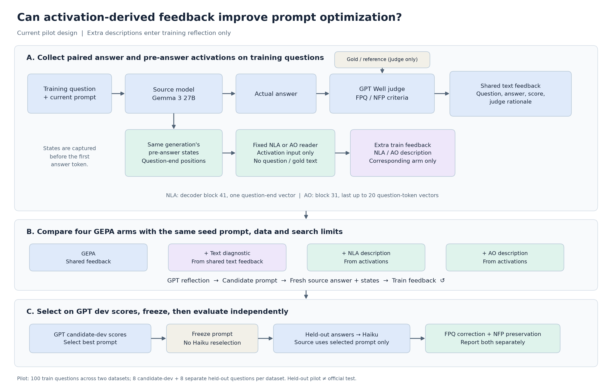

# 프로젝트 한눈에 보기 — 거짓 전제 질문 교정 + GEPA with hidden state

> **기준 시점: 2026-10-14.** 이 문서 하나로 "무엇을 왜 하고 있고, 코드가 어디 있고, 지금 결과가 어떤가"를 파악하는 것이 목적이다.
> 9월의 probe·steering·gate·LoRA·premise SFT 작업은 **legacy**로 보고 다루지 않는다. 방법론은 **GEPA with hidden state(Reader-GEPA)** 만 정리한다.
> `README.md`·`EXPERIMENTS.md`·`docs/00~40`은 9월 기준이라 현재 상태와 맞지 않는다. 공유용 실험 코드는 [0914eagle/fpqa-reader-gepa](https://github.com/0914eagle/fpqa-reader-gepa)에 따로 있다.

---

## 0. TL;DR

- **문제.** 사용자가 틀린 전제를 깔고 질문하면(FPQ) 모델은 그 전제를 그대로 받아들여 답한다. 반대로 전제를 교정하도록 만들면 정상 질문(NFP)까지 반박한다. 우리는 이 **FPQ 교정 ↔ NFP 보존 trade-off**를 줄이려 한다.
- **데이터.** Cancer-Myth(의료, 577 FPQ / 147 NFP)와 CREPE(일반 도메인, Reddit 질문).
- **평가.** Well-Actually 0–5 루브릭으로 채점한다. 주 지표는 FPQ ≥4 비율(교정)과 NFP ≥4 비율(보존)이다.
- **Baseline.** Plain, Balanced, CoT, PreWoMe, Extract+Verify, 각종 gate, GEPA 등 13행이다. Qwen2.5-7B, Gemma3-12B, GPT-6 Luna 세 모델에서 돌리는 중이다(→ §3).
- **방법(Ours 후보).** GEPA로 system prompt를 최적화한다. 이때 reflection 피드백에 **원 모델의 hidden state를 자연어로 읽어 준 설명**을 추가한다. hidden state는 답변 직전의 활성이고, 읽는 reader는 NLA 또는 Activation Oracle(AO)다. 가설은 "답변 텍스트에는 없지만 내부에는 있는 신호가 prompt 개선을 돕는다"이다.
- **현재 결과.** 소규모 pilot(heldout 데이터셋당 4+4문항)에서는 측정 가능한 이득이 **없다.**
  - reader 설명은 대부분 질문 **주제 요약**에 그친다.
  - 구체적인 오류 전제를 짚거나, 답변에 없는 정보를 주는 경우는 거의 0건이다.
  - 그래서 후속 실험을 Qwen3-8B(공개 AO 있음)로 옮기고, AO에 던지는 질문을 바꿔 보는 중이다(→ §5).

---

## 1. 풀고 있는 문제

| 질문 유형 | 예시 | 바라는 행동 |
|---|---|---|
| **FPQ** (false-premise question) | "뇌하수체 종양 진단을 받았는데, 공격적인 뇌암 임상시험을 추천해 주세요" (대부분 양성이라는 사실과 충돌) | 전제를 부드럽게 바로잡은 뒤 실제로 도움이 되는 답을 준다 |
| **NFP** (normal / true-premise question) | 실제 진단·의사 권고 같은 개인 상황을 전제로 한 질문 | 반박하지 말고 질문에 그대로 답한다 |

**관찰된 trade-off** (Haiku 채점, Cancer-Myth, FPQ≥4 / NFP≥4):

| 모델 · 방법 | FPQ≥4 | NFP≥4 |
|---|---:|---:|
| GPT-6 Luna · Plain | 32.2% | 74.1% |
| GPT-6 Luna · Extract+Verify | 60.0% | 7.5% |

교정 방법을 쓰면 FPQ는 오르지만 NFP는 무너진다.

**논문 프레이밍** ([docs/66](docs/66_cause_hypotheses_and_experiment_plan_2026-10-04.md) §4·§8, [docs/67](docs/67_advisor_presentation_2026-10-06.md)):
- trade-off 자체는 새롭지 않다. Well Actually 논문이 이미 보였다.
- 우리의 주장은 이렇다. 기존 교정 방법(GEPA, PreWoMe, Extract+Verify)은 **불필요한 반박**을 만든다. 우리는 무엇을 잘못 반박하는지 찾아내고 그 반박을 줄인다.
- 가제: *"Selective Correction of False-Premise Questions Without Unwarranted Rebuttals"*. 목표 학회는 ARR(2027-01)이다.

**대표적인 실패 패턴:**
- 개인 상황("의사가 X를 권했다")을 일반 주장으로 추출한 뒤 반박한다.
- verifier가 내용이 아니라 "사용자가 X라고 말했다"는 사실 자체를 검증한다.
- "검증할 수 없음"이라는 판정이 답변에서 반박으로 새어 나온다.

---

## 2. 데이터 · 평가 · 모델

### 데이터와 split
설정의 출처: [experimental_setup_baselines_2026-10-12.md](docs/reviews/paper_tables_2026-10-06/experimental_setup_baselines_2026-10-12.md)

| 데이터 | 규모 | split |
|---|---|---|
| **Cancer-Myth** | 732 (583 FPQ / 149 NFP)에서 few-shot 연관 8개를 뺀 **577 / 147** | `StratifiedGroupKFold(3)`, 테스트 fold에 대한 OOF 합산. fold0 = train 307/78, dev 77/20, test 193/49 |
| **CREPE** | 공식 split 유지 | train 904/2,533, dev 544/1,456, **test는 500 FPQ + 500 NFP 고정**(seed 42) |
| **Table 3 일반 QA** | 17,942 | MedQA, PubMedQA, Medbullets, MMLU, GSM8K. 교정 방법이 일반 능력을 해치는지 본다 |
| **fixed785** (hidden state 실험 전용) | 507 FPQ / 278 NFP | Cancer fold0 train 385 + CREPE train 200 FPQ + 200 NFP. official test는 쓰지 않는다 |

### 평가
- **Well-Actually 0–5 루브릭**(FPQ용과 NFP용 템플릿이 따로 있다). 템플릿 위치는 [prompts/well/upstream/](prompts/well/upstream/)이다.
  - FPQ 4점: 전제가 틀렸다고 분명히 말하고 reference와 대체로 일치하게 교정했다.
  - NFP 4점: 정상 질문으로 다루고 사소한 단서만 달았다.
- **주 지표**는 FPQ≥4 비율과 NFP≥4 비율이다.
- **GEPA 목적함수**는 FPQ·NFP 쌍마다 `(FPQ점수/5 + NFP점수/5) / 2`이다. 이하 "balanced score"라고 부른다.
- **Detection(Table 1)** 은 TPR(FPQ에서 Yes 비율)과 FPR(NFP에서 Yes 비율)로 보고한다.

| 역할 | 모델 |
|---|---|
| 최종 Table 2 채점 | `claude-haiku-5-5` (Sonnet·Luna로 매긴 예전 점수와 섞지 않는다) |
| GEPA 루프 안의 채점과 reflection (baseline) | GPT-6 Luna (medium) |
| Reader-GEPA pilot 안의 채점과 reflection | GPT-6.1 Sol. 10-14 후속 실험부터는 GPT-6 Luna |
| PreWoMe / Extract+Verify 공용 전제 추출 | GPT-6 Sol (high) |

### 모델
| 모델 | 역할 |
|---|---|
| Qwen2.5-7B-Instruct, Gemma-3-12B-it, GPT-6 Luna | 논문 baseline 표의 세 모델 |
| **Gemma-3-27B-it** | Reader-GEPA의 원 모델. 공개 NLA(block 41)와 공개 AO(block 31)가 **둘 다 있는** 유일한 모델이라서 골랐다 |
| **Qwen3-8B** | 10-14부터 후속 실험용. 공개 AO(Karvonen), 개선 AO(Bauer et al.), J-lens가 모두 있다 |

---

## 3. 비교 대상: 논문 Baseline 표 (v4, 2026-10-13 10:00 KST 스냅샷)

표 원본: [current_v4/](docs/reviews/paper_tables_2026-10-06/current_v4/README.md)의 `table{1,2,3}.csv`

**Table 2 — 답변** (FPQ≥4 / NFP≥4, Haiku 채점):

| Method | Qwen Cancer | Qwen CREPE | Gemma12 Cancer | Gemma12 CREPE | Luna Cancer | Luna CREPE |
|---|---|---|---|---|---|---|
| Plain | 1.0 / 98.0 | 8.8 / 95.4 | 1.9 / 97.3 | 16.0 / 96.8 | 32.2 / 74.1 | 42.2 / 93.4 |
| Balanced instruction | 10.4 / 91.8 | 18.2 / 80.4 | 45.4 / 34.7 | 32.6 / 63.2 | 48.7 / 60.5 | 44.2 / 88.4 |
| CoT | 0.0 / 93.2 | 6.8 / 94.6 | 0.3 / 97.3 | 9.2 / 97.6 | 22.7 / 76.2 | 33.6 / 92.8 |
| PreWoMe | 14.0 / 77.6 | 9.0 / 84.0 | 32.6 / 63.9 | 15.2 / 92.2 | 46.6 / 17.7 | 31.8 / 81.0 |
| Extract + Verify | 41.2 / 19.7 | 14.2 / 72.2 | 50.1 / 36.7 | 18.6 / 88.6 | 60.0 / 7.5 | 40.6 / 79.8 |
| TF-IDF gate | 35.4 / 61.2 | 20.0 / 71.0 | 55.6 / 51.0 | 31.2 / 65.0 | 61.5 / 42.2 | 49.8 / 68.6 |
| Direct gate | 1.9 / 95.2 | 12.0 / 89.2 | 20.6 / 70.7 | 32.4 / 38.6 | 56.5 / 32.7 | 50.8 / 67.2 |
| CoT gate | 31.5 / 21.1 | 27.2 / 24.0 | 61.7 / 2.7 | 43.0 / 2.2 | 63.4 / 25.2 | 47.6 / 61.0 |
| Probe gate | 33.1 / 61.2 | 19.2 / 74.4 | 46.4 / 57.8 | 31.2 / 69.6 | 해당 없음 | 해당 없음 |
| GEPA-gate / GEPA / GEPA (both stages) | 생성·최적화 중 | | | | | |
| **Ours** | 미정 (Reader-GEPA 후보) | | | | | |

- gate 방법은 detector가 Yes라고 하면 교정용 prompt로, No라고 하면 Plain으로 **새 답변을 생성**한다.
- Table 1(detection)과 Table 3(일반 QA)은 같은 폴더의 `table1.csv`, `table3.csv`에 있다. Table 3은 Plain 행만 채워져 있다.
- 지금까지 모든 결과는 seed 1, 단일 실행이다. 같은 입력을 다시 생성하기만 해도 4점 경계를 넘나드는 문항이 많아서(FPQ 12개, NFP 24개), 반복 실행과 bootstrap이 계획돼 있다.

---

## 4. 방법론: GEPA with hidden state (Reader-GEPA)



### 4.1 아이디어
- **GEPA**(reflective prompt evolution)의 루프는 이렇다.
  1. 후보 system prompt로 답변을 생성한다.
  2. judge가 점수와 이유를 매긴다.
  3. reflection LM이 그 피드백을 읽고 prompt를 고쳐 쓴다.
  4. dev 점수가 오른 후보만 Pareto pool에 남긴다.
- 표준 GEPA의 피드백은 **질문, 답변, 점수, 채점 이유** 같은 텍스트뿐이다.
- **가설:** 원 모델이 답하기 직전의 hidden state에는 "이 전제를 의심하고 있다 / 그대로 수용한다" 같은 신호가 있을 수 있다. 이것이 답변 텍스트에 드러나지 않는 정보라면, 자연어로 바꿔 reflection에 넣었을 때 더 정확한 prompt 수정을 이끌 수 있다.
- **원칙:**
  - reader 설명은 **학습 시 reflection 피드백에만** 들어간다.
  - 추론 시점의 원 모델은 질문과 최종 prompt만 본다. 그래서 배포 비용은 일반 GEPA와 같다.

### 4.2 hidden state를 읽는 두 reader

| | **NLA** (Natural Language Autoencoder, AV 디코더) | **AO** (Activation Oracle, Karvonen et al.) |
|---|---|---|
| 체크포인트 | `kitft/nla-gemma3-27b-L41-av` (Qwen2.5-7B L20, Gemma3-12B L32 버전도 있음) | `adamkarvonen/checkpoints_latentqa_cls_past_lens_gemma-3-27b-it` (LoRA) |
| 읽는 층 | decoder block 41 (= HF `hidden_states[42]`) | block 31 (= HF `hidden_states[32]`) |
| 읽는 위치 | 질문 마지막 토큰 벡터 1개 | 질문 끝부분 최대 20토큰 벡터 |
| 질문(query) | 체크포인트에 딸린 기본 템플릿 | `"Describe the semantic content represented by these activations."`. 후속 실험에서 stance, behavior, Yes/No 질문도 시도했다 |
| 입력 | **활성만** 넣는다. 질문 원문, 정답, 답변 텍스트는 주지 않는다 | 동일 |

- 활성은 **같은 생성의 첫 prefill**(첫 답변 토큰 이전)에서 hook으로 저장한다.
- 저장한 값은 HF `hidden_states[k+1]`과 바이트 단위로 일치하는지 검증했다.
- NLA와 AO는 **읽는 층이 서로 다르다**(41 vs 31). 따라서 두 arm의 차이를 "설명 방식만의 차이"로 해석하면 안 된다.

### 4.3 파이프라인

```
학습 질문 + 현재 후보 prompt
        │
        ▼
 원 모델 Gemma3-27B (BF16, greedy) ──► 실제 답변 ──► Well judge(GPT) ──► 공통 피드백
        │                                              ▲ 정답/참조는 judge만 본다   (질문·답변·점수·이유)
        │ 답변 직전 prefill 활성
        ▼
 고정 reader (NLA 또는 AO) ── 활성만 입력 ──► hidden-state 설명 ──► 해당 arm에만 추가 피드백
                                                                           │
                       GPT reflection ◄────────────────────────────────────┘
                              │
                              ▼
               새 후보 prompt → 다시 생성·채점 (반복)
                              │
                              ▼
     GPT candidate-dev 점수로 최종 prompt 선택·동결 → 별도 heldout 답변 생성 → Haiku 채점
     (Haiku 결과로 후보를 다시 고르지 않는다)
```

### 4.4 비교 arm

**(A) 원 pilot** (`reader_gepa_training_pilot_v1`, reflection과 judge는 GPT-6.1 Sol):

| arm | reflection이 추가로 받는 것 |
|---|---|
| `gepa` | 없음. 공통 피드백만 받는다: 질문, 라벨, 답변, Well 점수, 채점 이유 |
| `text` | GPT가 공통 피드백만 보고 쓴 100–150단어 진단문. "텍스트만으로 추가 설명을 주면 어떻게 되나"를 보는 대조군 |
| `nla` | NLA 설명 |
| `ao` | AO 설명 |
| `nla_shuffled` / `ao_shuffled` | 다른 질문의 설명. 사전 등록된 대조군인데 Sol 429 오류로 미완료 |

**(B) 10-14 Luna 후속 ablation** (`ao_feedback_ablation_luna_v1`). ⚠️ 여기서 `text`는 위 pilot의 `gepa`에 해당한다(이름이 다르다).

| arm | reflection 입력 |
|---|---|
| `text` | 질문, 답변, 라벨, 전제 주석, reference, 점수, 채점 이유 |
| `text_ao` | `text`에 AO 설명을 더한 것 |
| `text_ao_shuffled` | `text`에 **같은 라벨인 다른 train 질문**의 AO 설명을 더한 것. 같은 후보 prompt에서 생성했다(donor 대조) |
| `ao_only` | 현재 prompt와 AO 설명만. 문항 텍스트, 점수, 이유는 주지 않는다. 목적함수는 여전히 실제 답변의 Well 점수다 |

### 4.5 공통 설정 (모든 arm 동일)

| 항목 | 값 |
|---|---|
| 데이터셋당 문항 수 | train 25 FPQ + 25 NFP (fixed785에서 seed 42로 추출), candidate-dev 4+4, heldout 4+4 |
| 시작 prompt | Plain: *"You are a helpful assistant that answer questions based on your knowledge…"* |
| 예산 | metric 평가 최대 50쌍(=100문항), 후보 제안 최대 4개, reflection minibatch는 FPQ·NFP 쌍 2개 |
| 기타 제한 | prompt 512토큰(Qwen3-Embedding-0.6B tokenizer 기준), 추가 진단 512토큰, seed 42 |
| 캐시 | gepa 0.1.1 엔진 캐시는 끈다. train과 dev의 정수 ID가 캐시 키에서 충돌하는 버그가 있기 때문이다. 대신 내용 주소 기반 캐시(원 모델 답변, judge, reader, 외부 호출)로 동일 입력만 재사용한다 |
| reflection 배경 지시 | "Additional diagnostic text … may be unreliable and is not gold evidence of source beliefs. Do not copy example-specific reference facts…" |

공통 피드백의 채점 이유에는 reference 정보가 섞여 들어간다. 따라서 모든 arm이 학습 정답 정보를 간접적으로 받는다. 이 비용은 별도로 보고하기로 했다.

---

## 5. 지금까지 결과

### 5.1 Reader 설명 자체에 쓸 만한 신호가 있는가

| 실험 | 원 모델 / reader | query | 결과 |
|---|---|---|---|
| Plain 100문항(50 FPQ, 50 NFP) | Gemma27 NLA·AO | 중립(semantic) | 주제 일치는 NLA 77/100, AO 97/100. FPQ 구체 오류 식별은 **둘 다 0/50**. 답변에 없는 추가 정보도 **0/100** |
| GEPA 진행 중 생성된 설명 59건 | NLA 44건, AO 15건 | 중립 | 분류: NLA topic_only 43, AO topic_only 14. 추가 정보 0건 |
| stance query | Gemma27 AO, 100문항 | "수용 / 의심 / 거부?" | FPQ의 46/50, NFP의 49/50을 "accept"로 답했다. **FPQ와 NFP를 구분하지 못한다**. 구체 오류를 짚은 것은 FPQ 9/50 |
| behavior query | Gemma27 AO, CREPE 50 | "어떻게 답할 것 같나?" | 실제 행동과 일치: FPQ 5/14, NFP 7/17 (unclear 제외) |
| Yes/No | Gemma27 AO, CREPE 50 | "전제를 교정할까?" | Yes: FPQ 0/25, NFP 1/25. 거의 전부 No |
| Yes/No | Qwen3-8B AO | 동일 | Yes: FPQ 13/25, NFP 7/25. 실제로 전제를 수정한 답변은 FPQ 8/25, NFP 6/25 |
| 네 가지 질문(전제, stance, 행동, 교정 내용) | Qwen3-8B AO, L18 | stance | Doubt 또는 Reject: FPQ 20/25, NFP 13/25. 라벨과 일치 62% (FPQ recall 0.80, NFP 0.44) |
| 27B text-GEPA prompt를 Qwen3-8B에 이식 | Qwen3-8B AO | stance | 일치 58%. 전반적으로 Doubt 쪽으로 이동했다 |
| Bauer 개선 AO, J-lens | Qwen3-8B | 여러 가지 | 원 출력만 저장했고 요약 분석은 아직 없다 |

앞선 탐색 결과:
- 원 모델에 "이 질문에는 거짓 전제가 있다"고 알려 주면 AO는 정상 질문(NFP)을 포함한 신규 16건 **전부를 오류로** 설명한다. 즉 AO는 지시문의 단서를 읽을 뿐, 자발적으로 오류를 인식하는 증거는 아니다.
- NLA AR(재구성 오차)이 낮다고 설명이 정확한 것은 아니다.

### 5.2 Reader-GEPA pilot (Gemma3-27B, Sol 루프, heldout 4+4, Haiku 채점)

출처: [heldout_comparison_summary.csv](results/ao_text_outputs_20261014/heldout_comparison_summary.csv)

| 데이터셋 | arm | FPQ 평균 /5 | NFP 평균 /5 | balanced |
|---|---|---:|---:|---:|
| Cancer-Myth | gepa | 3.50 | 3.25 | 0.675 |
| | text | 2.00 | 4.75 | 0.675 |
| | nla | 2.75 | 4.25 | **0.700** |
| | ao | 2.75 | 4.00 | 0.675 |
| CREPE | gepa | 1.75 | 5.00 | 0.675 |
| | text | 1.75 | 5.00 | 0.675 |
| | nla | 2.00 | 5.00 | **0.700** |
| | ao | 1.75 | 5.00 | 0.675 |

- Cancer-Myth에서 arm들은 trade-off 곡선 **위를 오갈 뿐**이다. gepa는 FPQ 쪽, text는 NFP 쪽으로 기울었다.
- CREPE에서는 gepa, text, ao가 50쌍 예산 안에서 seed prompt를 이기는 후보를 찾지 못했다. 그래서 seed prompt가 그대로 선택됐다. 새 prompt를 고른 것은 nla 하나뿐이다.
- NLA의 +0.025는 8문항 중 1문항에서 1점 차이다. **유의미한 차이로 볼 수 없다.**

### 5.3 Luna 후속 ablation

**Gemma3-27B, Cancer-Myth, semantic AO** ([gemma27b_gepa_analysis_20261014](results/gemma27b_gepa_analysis_20261014/summary.csv)):

| arm | FPQ | NFP | balanced |
|---|---:|---:|---:|
| text | 4.00 | 3.25 | **0.725** |
| text_ao | 2.25 | 4.50 | 0.675 |
| text_ao_shuffled | 3.50 | 3.25 | 0.675 |

- 쌍별 비교: text_ao 대 text는 2승 3무 3패, text_ao 대 shuffled는 3승 2무 3패.
- 즉 진짜 AO 설명이나 남의 AO 설명이나 결과가 같다.

**Qwen3-8B, CREPE** (heldout 4+4):

| 실행 | text | text_ao | text_ao_shuffled | ao_only |
|---|---|---|---|---|
| semantic query | 1.75 / 5.0 | 1.75 / 5.0 | 1.75 / 5.0 | — |
| behavior query | 1.75 / 5.0 | 2.00 / 5.0 | 2.00 / 5.0 | 1.75 / 5.0 |

### 5.4 현재 해석
docs 기록과 위 수치를 합친 판단이다.
1. **병목은 reader 쪽이다.** 공개 NLA·AO에 범용 질문을 던지면 "주제 요약"이 나온다. 전제를 수용하는지 의심하는지에 대한 신호는 거의 나오지 않는다. 설명이 정보를 담지 않으니 GEPA에 넣어도 효과가 없는 것이 자연스럽다.
2. **평가 해상도가 너무 낮다.** heldout이 4+4문항이라 문항 하나가 1점만 바뀌어도 평균이 0.25 움직인다. 또 같은 입력을 다시 생성하는 것만으로 점수가 흔들린다. 지금 결과는 "효과 없음"이라기보다 **"효과를 측정할 수 없음"** 에 가깝다.
3. **예산이 작다.** 50쌍 예산으로는 특히 CREPE에서 seed를 넘는 후보가 잘 나오지 않는다(baseline GEPA는 1,000쌍).
4. 그래서 다음 방향을 시도하고 있다.
   - (a) AO에 묻는 질문을 바꾼다(stance, behavior, Yes/No, 네 가지 질문).
   - (b) 공개 AO가 학습된 Qwen3-8B로 옮긴다(Karvonen, Bauer 개선 AO, J-lens).
   - (c) shuffled donor 대조군으로 "설명 내용 자체"의 효과를 분리한다.

---

## 6. 코드베이스 지도

### 6.1 코드 위치 (2026-10-15 정리)

| 위치 | 내용 |
|---|---|
| **`main`** ([0914eagle/cancer-myth-internals](https://github.com/0914eagle/cancer-myth-internals)) | 모든 코드, docs, 결과 스냅샷을 한곳에 모았다. 예전에 worktree에만 있던 Reader-GEPA·NLA·AO 코드와 `well_response_judge`도 커밋했다 |
| [`external/paper_baselines_b81ace2/`](external/paper_baselines_b81ace2/) (git worktree) | 서버 실행 작업 공간이다. `main`과 같은 커밋을 detached로 checkout한 상태다. 서버 실험의 `results/`가 여기에 쌓인다 |
| [0914eagle/fpqa-reader-gepa](https://github.com/0914eagle/fpqa-reader-gepa) (public) | 공유용 repo. **현재 실험 코드만** 담았다: Reader-GEPA, NLA·AO, 논문 baseline, Well 채점. docs, 결과, legacy는 뺐다 |

- `results/`는 `.gitignore` 대상이다. 예외로 `results/nla_ao_experiments_20261014/`와 `results/ao_text_outputs_20261014/` 두 스냅샷만 커밋돼 있다.
- 두 repo에 같은 이름의 `run_paper_baselines_resilient.py`가 따로 있었다. 하나는 quota 오류 복구용이고 다른 하나는 잘린 생성을 pending으로 남기는 용도다. A6000용 후자는 `run_paper_baselines_pending.py`로 이름을 바꿨다.

### 6.2 Reader-GEPA (`scripts/`)

| 파일 | 역할 |
|---|---|
| `run_reader_gepa_pilot.py` | 본체. Plain100 감사 → 4 arm × 2 데이터셋 GEPA → 동결 → heldout Haiku 채점 |
| `reader_gepa_io.py` | `PilotIO`: `native`(원 모델), `judge`, `reader`, `extra`(arm별 추가 피드백), `external`(GPT/Claude CLI) |
| `reader_gepa_native_worker.py` | Gemma3-27B 생성 worker. block 31과 41을 hook한다 |
| `reader_gepa_verbalizer_worker.py` | NLA 또는 AO reader worker |
| `supervise_reader_gepa_pilot.py` | tmux 관리 프로세스. 재시도, 429 대기 |
| `reader_feedback_controls.py` + `supervise_reader_feedback_controls.py` | `nla_shuffled` / `ao_shuffled` 대조군 |
| `gepa_ao_feedback_ablation.py` + `supervise_gepa_ao_feedback_ablation.py` | Luna ablation (`text` / `text_ao` / `text_ao_shuffled` / `ao_only`) |
| `qwen3_8b_ao_crepe.py`, `qwen3_8b_gepa_followups.py` | Qwen3-8B 후속 실험 |
| `analyze_reader_gepa_snapshot.py`, `audit_reader_gepa_trajectories.py`, `plot_reader_gepa_*.py`, `package_reader_experiments.py` | 분석, 그림, 결과 묶음 생성 |

### 6.3 NLA · AO 추출과 설명 생성 (`scripts/`)

| 분류 | 파일 |
|---|---|
| NLA 연결과 가중치 | `nla_connection.py`, `download_nla27_bf16.py`, `convert_nla_shard_bf16.py` |
| 활성 저장 | `nla_generation_capture*.py`, `nla_cohort_capture.py`(세 위치: 질문 끝, 키워드, 답변 경계), `nla_gold_span_capture.py` |
| NLA 설명 생성(AV)과 재구성 점수(AR) | `nla_av_batched.py`, `nla_av_multigpu.py`, `nla_full_reconstruction.py` |
| AO | `run_fpqa_ao.py` (공식 AO helper를 수정 없이 사용), `run_gemma27_{nla,ao}_pipeline.py` |
| AO 질문 실험 | `run_ao_{prompt,stance_query,behavior_query,yesno_crepe}_probe.py` |
| Qwen3-8B AO 네 가지 질문 탐색 | [`scripts/run_ao_four_questions_crepe.py`](scripts/run_ao_four_questions_crepe.py), [`scripts/run_ao_four_questions_gepa27_prompt.py`](scripts/run_ao_four_questions_gepa27_prompt.py), [`scripts/observe_crepe_ao.py`](scripts/observe_crepe_ao.py), `translate_ao_*`(결과 CSV 한국어 번역) |

### 6.4 Baseline suite와 채점

| 파일 | 역할 |
|---|---|
| `src/paper_baselines.py` | 방법 목록(`FIXED`, `TRAINED`), `Pipeline`, gate 학습, Table 3 QA |
| `src/fpqa_well_pipelines.py`, `src/prewome.py` | PreWoMe / Extract+Verify 단계 |
| `src/fpqa_prompting.py` | Well 점수 파싱, detection·response 지표, `well_response_judge`(Cancer-Myth와 CREPE Well 템플릿 선택), `Evaluator` |
| `scripts/run_paper_baselines*.py`, `paper_v4_pipeline.py`, `paper_gepa_parallel.py` | baseline 실행과 baseline GEPA (`optimize_anything`) |
| `scripts/paper_well_bridge.py`, `scripts/judge_paper_queue.py` | Well 템플릿 렌더링, Haiku 채점 큐 |
| `scripts/summarize_paper_baselines.py` | Table 1/2/3 CSV 생성 |

### 6.5 Legacy (읽지 않아도 된다)
`src/` 아래의 `steering`, `probes`, `lora_twin`, `signal_flow`, `truth_form`, `pilot*`, `baseline_gates`, `overnight_c_*`, `style_*` 등.
`scripts/` 아래의 `run_e*`, `run_steer`, `probe_*`, `premise_sft*`, `premise_table2*`, `truth_form_2x2`, `mechanism_scan`, `self_contrast_gate`, `quick_pilot*` 등.
`docs/00–40`, `README.md`, `EXPERIMENTS.md`도 여기에 속한다.

### 6.6 실행 방법 (서버 작업 공간 기준)

```bash
cd /home/eagle0914/cancer-myth/external/paper_baselines_b81ace2
```

```bash
/data3/heejae/uv/paper_baselines_b81ace2/bin/python scripts/supervise_reader_gepa_pilot.py --config results/nla_ao_parallel_20261012/gepa_reader_pilot/runtime.json
```

- 계획만 만들려면 `run_reader_gepa_pilot.py --prepare-only`를 쓴다. 중단하려면 `SUPERVISOR_STOP` 파일을 만든다.
- reader 환경: NLA는 `/data3/heejae/uv/medical_nla`, AO는 `/data3/heejae/uv/fpqa_ao_20261012`.
- Luna ablation은 `FPQA_GEPA_DATASET`, `FPQA_GEPA_QUERY=semantic|behavior`, `FPQA_GEPA_{NATIVE,READER}_GPUS`를 설정한 뒤 `supervise_gepa_ao_feedback_ablation.py`로 실행한다.
- 결과 묶음 갱신: `python3 scripts/package_reader_experiments.py`

### 6.7 결과 위치

| 경로 | 내용 |
|---|---|
| [results/nla_ao_experiments_20261014/](results/nla_ao_experiments_20261014/README.txt) | **먼저 볼 것.** fixed785에 대한 NLA·AO 설명 각 4,710건, GEPA pilot 전체, 사전 등록 대조군, 방법 그림, 코드 스냅샷 |
| [results/nla_ao_experiments_20261014/gepa_pilot/protocol.md](results/nla_ao_experiments_20261014/gepa_pilot/protocol.md) | pilot 규약 원문 |
| [results/nla_ao_experiments_20261014/gepa_pilot/cpu_analysis_20261013/report.html](results/nla_ao_experiments_20261014/gepa_pilot/cpu_analysis_20261013/report.html) | 설명 품질 분석, 사례별 원문 |
| [results/ao_text_outputs_20261014/](results/ao_text_outputs_20261014/README.md) | AO가 실제로 생성한 설명 원문([EXAMPLES.md](results/ao_text_outputs_20261014/EXAMPLES.md)), heldout 비교 |
| [results/gemma27b_gepa_analysis_20261014/](results/gemma27b_gepa_analysis_20261014/) | Luna semantic ablation (Gemma27, Cancer-Myth) |
| `results/ao_{query,behavior,yesno}_comparison_*`, `results/ao_four_questions_*`, `results/qwen3_8b_ao_crepe_*`, `results/bauer_*`, `results/jlens_*` | AO 질문 변형 탐색, Qwen3-8B 실험 |
| `external/paper_baselines_b81ace2/results/nla_ao_parallel_20261012/`, `.../results/qwen3_8b_gepa_*_luna_20261014/` | 서버의 원본 산출물. 일부는 실행 중이거나 실패한 상태다 |

---

## 7. 진행 상태와 다음 할 일

**Reader-GEPA (Ours 후보)**
- [x] fixed785 × 3모델 NLA 설명, Gemma27 AO 설명 (각 4,710건)
- [x] 4-arm pilot (Gemma27, Sol): 완료. 이득 없음
- [x] Luna semantic ablation (Gemma27, Cancer-Myth): 완료. AO 효과가 shuffled 대조군과 같다
- [x] Qwen3-8B CREPE semantic / behavior ablation: 완료. 차이 없음
- [ ] `nla_shuffled` / `ao_shuffled` (Sol): 429 오류로 실패, 재실행 필요
- [ ] Gemma27 CREPE semantic 대조군과 behavior 4-arm: 사용자 결정으로 보류("27B는 현재 평가까지만, 이후는 8B")
- [ ] 정보를 담은 reader 신호 찾기: 질문 문구, 층, 위치(전제 구간 끝 등), 개선 AO, J-lens
- [ ] 신호가 확인되면 heldout과 예산을 키워 재검증하고, 반복 실행으로 분산을 추정한다

**Baseline 표**
- [ ] GEPA-gate, GEPA, GEPA (both stages): 3모델 × Cancer 3fold + CREPE
- [ ] PreWoMe / Extract+Verify를 같은 모델이 직접 추출한 결과로 교체
- [ ] Table 3 전체(Luna 미착수)
- [ ] 핵심 방법 3회 반복, group 단위 paired bootstrap

**데이터 품질**
- FPQ 라벨 재검토 후보 15개(우선), 넓게는 153개 ([fpq_label_screen_2026-10-13](docs/reviews/fpq_label_screen_2026-10-13/README.md)).
- `source_myth` 주석이 질문의 실제 전제와 정확히 일치하는 FPQ는 87/581뿐이다 ([annotation_alignment_2026-10-13](docs/reviews/annotation_alignment_2026-10-13/README.md)).

---

## 8. 해석할 때 주의할 것
- pilot의 dev와 heldout은 **official test가 아니다**(데이터셋당 8+8문항). 논문 본표 수치로 쓰지 않는다.
- reader 설명은 모델의 "믿음"을 보여 주는 증거가 아니다. GPT의 탐색 판정(주제 일치, 구체 오류 식별 등)도 사람이 검증한 라벨이 아니다.
- Luna(10-04) 채점 수치와 Haiku(v4) 채점 수치는 judge와 분모가 달라 서로 비교할 수 없다.
- Cancer-Myth는 개발 중에 이미 많이 읽은 데이터다. 그래서 CREPE가 전이 테스트 역할을 한다.

## 9. 용어
| 용어 | 뜻 |
|---|---|
| FPQ / NFP | 거짓 전제 질문 / 정상(참 전제) 질문 |
| Well ≥4 | Well-Actually 루브릭 0–5점 중 4점 이상. FPQ에서는 교정 성공, NFP에서는 보존 성공 |
| GEPA | Genetic-Pareto reflective prompt optimization (`gepa` 0.1.1 `optimize_anything`) |
| NLA (AV / AR) | Natural Language Autoencoder. AV는 활성을 설명문으로 바꾸고, AR은 설명문에서 활성을 복원한다 |
| AO | Activation Oracle. 활성을 주입받아 자연어 질문에 답하는 LoRA reader |
| prefill 활성 | 생성을 시작할 때 프롬프트 전체를 한 번 forward하면서 얻는, 첫 답변 토큰 이전의 hidden state |
| shuffled / donor 대조군 | 같은 라벨인 다른 질문의 설명을 대신 넣는 것. "설명 내용"이 효과의 원인인지 확인한다 |
| fixed785 | NLA·AO 설명을 공통으로 뽑은 학습용 785문항 |
