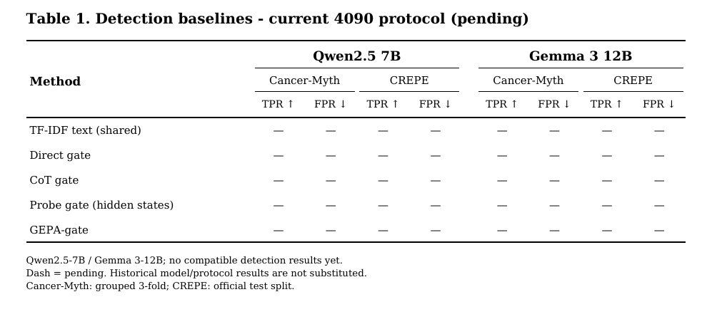
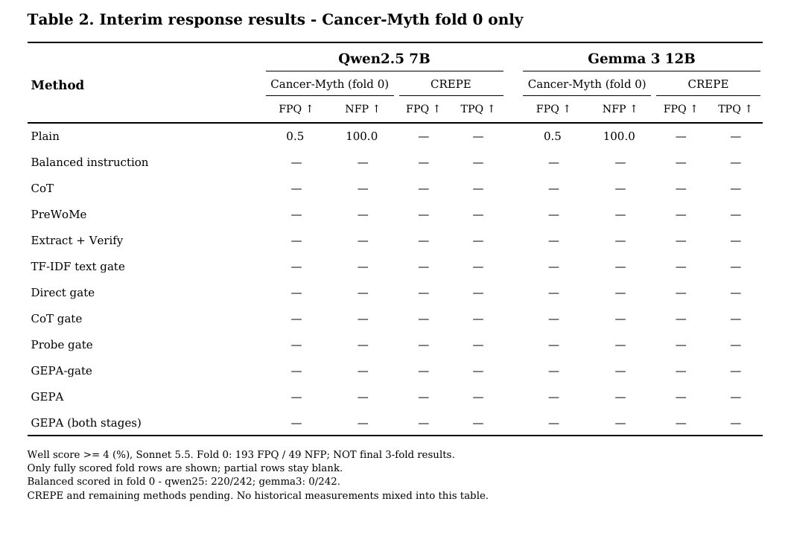
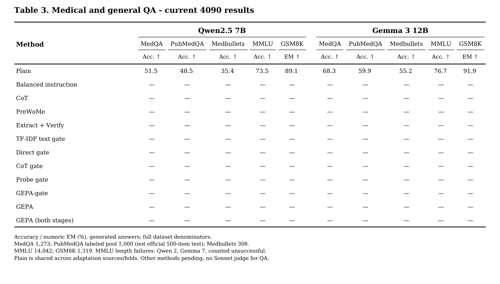

# Current 4090 baseline tables (2026-10-12)

Qwen2.5-7B와 Gemma 3-12B만 포함한다. 과거 Gemma 4·Qwen3.8 결과는 상위 폴더에 그대로 보존한다.
Table 2는 첫 fold 중간 결과이며 최종 3-fold 결과가 아니다. 전체 fold 집계는 원장 완성 후 교체한다.
같은 fold에서 두 클래스가 모두 채점된 행만 표시한다. Balanced의 부분 점수는 비교 표에 넣지 않는다.
Table 3의 Plain은 전체 평가 풀 처리가 끝났다. 생성 실패는 분모에 포함하고 정답으로 세지 않는다.
일반 QA 채점은 정답 문자열/숫자 비교이며 Sonnet 채점이 아니다.

## Table 1

[PDF](table1.pdf) · [CSV](table1.csv) · [LaTeX](table1.tex)

## Table 2

[PDF](table2.pdf) · [CSV](table2.csv) · [LaTeX](table2.tex)

## Table 3

[PDF](table3.pdf) · [CSV](table3.csv) · [LaTeX](table3.tex)

## 완료된 정확한 집계

| Model | Dataset | Correct / Total | Generation failures |
|---|---|---:|---:|
| qwen25 | medqa | 655/1273 | 0 |
| qwen25 | pubmedqa | 485/1000 | 0 |
| qwen25 | medbullets | 109/308 | 0 |
| qwen25 | mmlu | 10323/14042 | 2 |
| qwen25 | gsm8k | 1175/1319 | 0 |
| gemma3 | medqa | 869/1273 | 0 |
| gemma3 | pubmedqa | 599/1000 | 0 |
| gemma3 | medbullets | 170/308 | 0 |
| gemma3 | mmlu | 10764/14042 | 7 |
| gemma3 | gsm8k | 1212/1319 | 0 |

원장: [current_snapshot.json](current_snapshot.json). 재생성: 상위 폴더의 `update_current_4090.py`.
