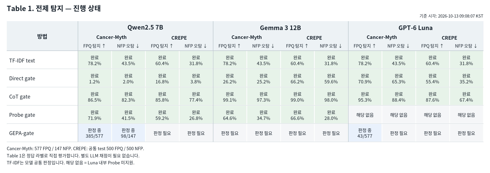
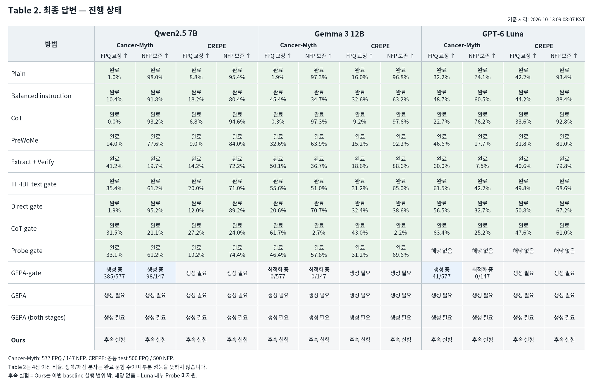
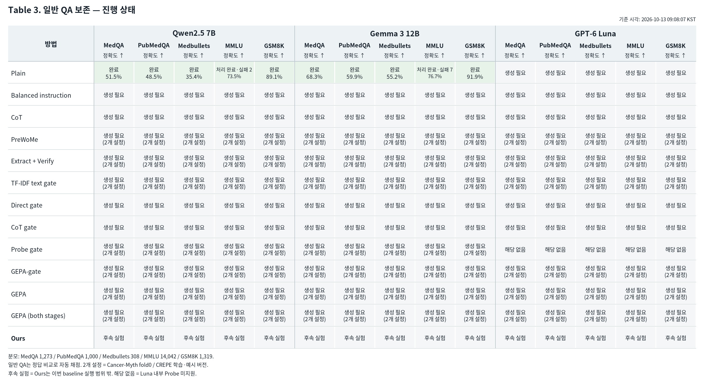

# 세 모델 baseline 진행 상태

기준: 2026-10-13T09:08:07.161980+09:00

빈칸 대신 자연어 상태를 표시했습니다. 완료된 셀만 성능 수치를 표시합니다.

완료된 셀은 해당 평가 문항의 채점이 모두 끝난 결과입니다.

## Table 1

[CSV](table1.csv) · [SVG](table1.svg)

## Table 2

[CSV](table2.csv) · [SVG](table2.svg)

## Table 3

[CSV](table3.csv) · [SVG](table3.svg)
